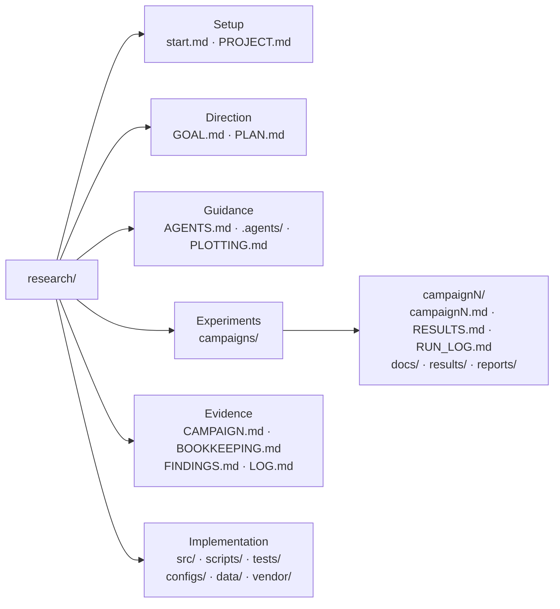

# research

A starter for machine learning and AI-for-science projects.
Keep goals, experiments, evidence, and compute costs together.
Begin with defaults or a short guided conversation.

## Start

1. Select **Use this template** on GitHub and clone your new repository.
2. Open [start.md](start.md), or ask your agent:

   > Read start.md and help me set up this research project.

3. Choose **Use defaults** or **Guide me**. Skip anything and return later.

No packages are required. The template includes Markdown, four workflow skills, and empty working directories.

## Where things live

The diagram uses [Mermaid](https://docs.github.com/en/get-started/writing-on-github/working-with-advanced-formatting/creating-diagrams), rendered directly by GitHub. Campaign 0 is reserved for setup checks.

| When you need to… | Read or update |
| --- | --- |
| Set up the project | [start.md](start.md), [PROJECT.md](PROJECT.md) |
| Define the question and next step | [GOAL.md](GOAL.md), [PLAN.md](PLAN.md) |
| Plan one experiment | [Campaign guide](campaigns/TEMPLATE.md), [CAMPAIGN.md](CAMPAIGN.md) |
| Understand the evidence | [BOOKKEEPING.md](BOOKKEEPING.md), [FINDINGS.md](FINDINGS.md) |
| Trace what ran | [LOG.md](LOG.md), each campaign's RUN_LOG.md |
| Work with an agent | [AGENTS.md](AGENTS.md), [skills](.agents/README.md) |
| Make a figure | [PLOTTING.md](PLOTTING.md) |

## Work in campaigns

The idea of organizing LLM-assisted research into campaigns comes from a talk by my lab mate [Michael Y. Li](https://michaelyli.github.io/), which I found very useful.

**Question → budget and design → check → run → record → decide.**

Each campaign tests one hypothesis. Keep its protocol, results, reports, and logs together; keep reusable code in `src/`. Preserve failures and negative results. Setup may finish with TODOs; an experiment needs an agreed design and budget.

| Campaign | Results | History |
| --- | --- | --- |
| 0 — setup checks | [RESULTS.md](campaigns/campaign0/RESULTS.md) | [RUN_LOG.md](campaigns/campaign0/RUN_LOG.md) |

Defaults: W&B with local TensorBoard, configurable during setup. Keep credentials, raw data, weights, and tracking payloads out of Git; review staged files before publishing.

[MIT license](LICENSE). Added tools, data, and models retain their own licenses.
